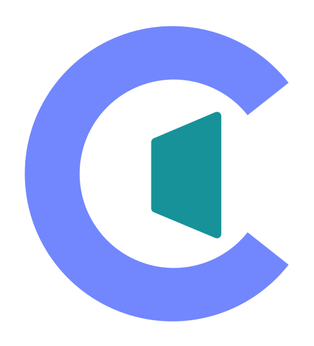
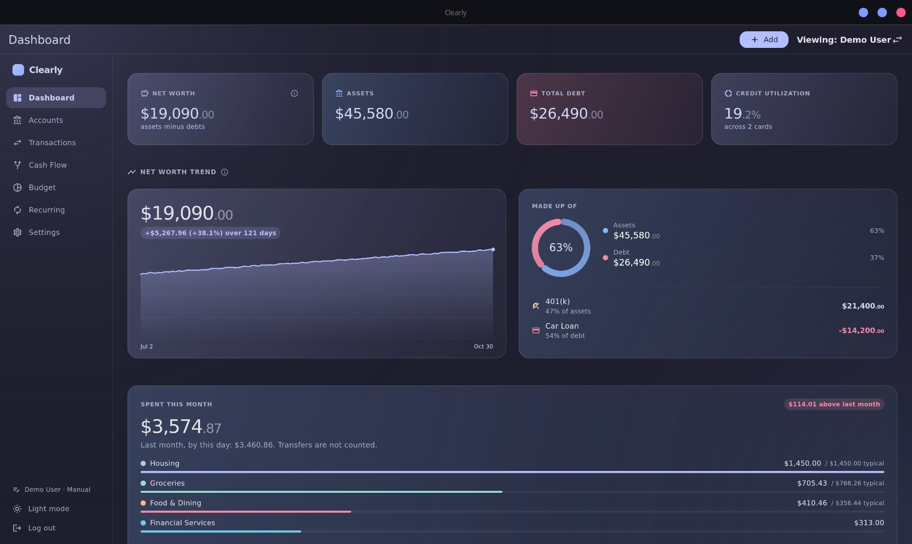
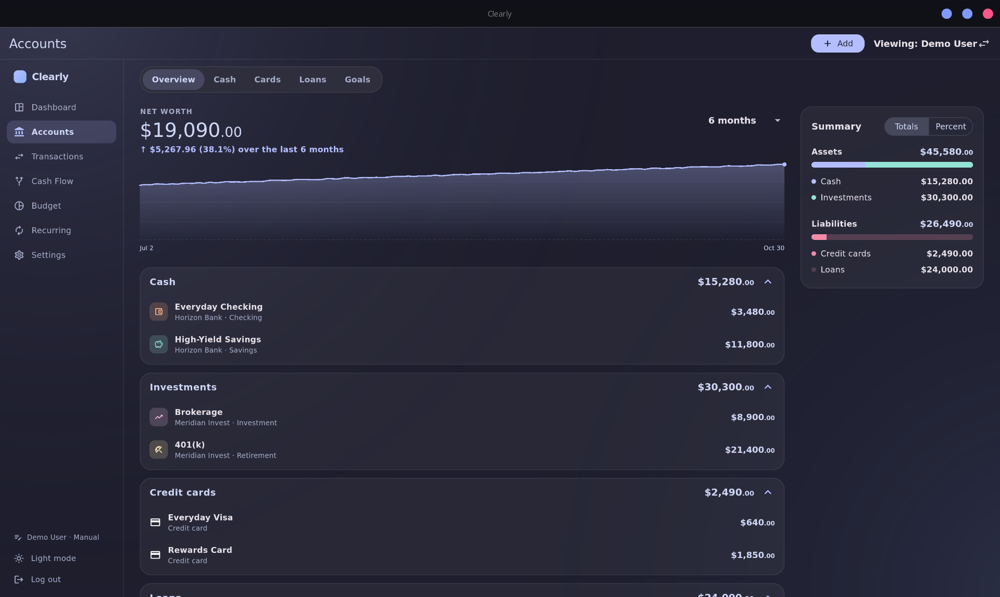
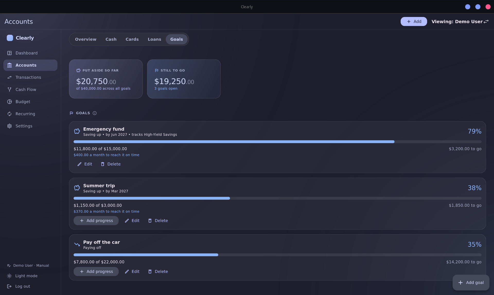
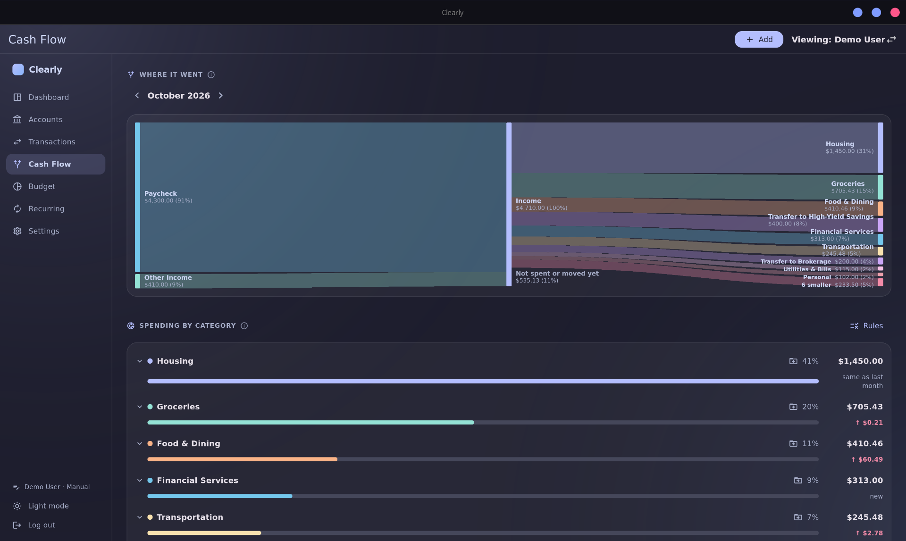
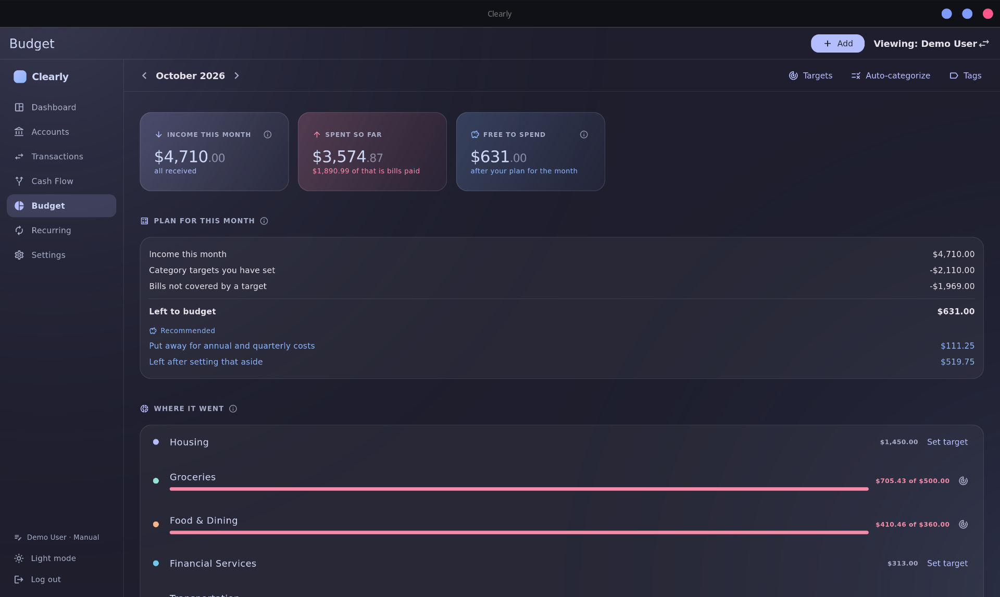

<picture>
  <source media="(prefers-color-scheme: dark)" srcset="docs/logo/clearly-mark.svg">
  
</picture>

# Clearly

### __Knowing your financial health shouldn't cost you $15 a month.__

[seeclearly.app](https://seeclearly.app)

### [⬇ Download for Linux](https://github.com/Psalm2517/clearly-finance/releases/latest/download/Clearly-x86_64.AppImage)

One file. Make it executable (right-click, Properties, Permissions), then double-click it.

Free, open-source personal finance for the desktop. Your data stays on your
computer.

## Why Clearly

- **Free.** No subscription, no account.
- **Flexible.** Type things in manually, or connect your banks through
  SimpleFIN ($1.50/month, paid to them).
- **Accurate.** Transfers between your own accounts and card payments aren't
  counted as spending or income.
- **Local.** Your data never leaves your device.

## Features

**Dashboard.** Net worth and what it is made of, how this month's spending
compares with last month's, and a short list of anything worth your
attention: a projected shortfall, high card use, a category running hot.

**Accounts.** Every account, card and loan in one overview, with tabs for
cash, cards, loans and goals. Loans show payoff progress and a "what if" for
extra payments. Goals track a savings or payoff target.

**Transactions.** A searchable register across every month, with filters,
tags and split transactions.

**Cash Flow.** Where the month's money came from and where it went, spending
by category, and a projected balance that warns you before it goes negative.

**Budget.** Targets for each category, with bills and paychecks counted in
the plan, so every dollar is counted once.

**Recurring.** Upcoming bills, paychecks, transfers and repeating
transactions. Clearly also finds subscriptions and regular deposits in your
history and offers to track them.

**Households.** Multiple profiles, each with its own data and an optional
PIN. An admin can switch into any of them.

## Clearly Sync

Create a **Synced** profile and connect your banks through
[SimpleFIN](https://www.simplefin.org/), a read-only feed. Accounts and
transactions come from the bank, they update daily, and nothing is typed in
by hand. A **Manual** profile never connects to anything.

## Your data

Everything is stored in `~/.local/share/app.seeclearly.Clearly/clearly.sqlite`.
Back up and restore from Settings. Backups are plain JSON, so keep them
somewhere you trust.

## Theme

Light and dark, with the [Catppuccin](https://catppuccin.com) flavors (Mocha
by default) and a choice of accent color.

## Building

See [BUILD.md](BUILD.md).

## Architecture

    lib/
      data/         Drift schema, repository, bank sync, backup
      screens/      One file per screen
      widgets/      Shared UI pieces
      theme/        Catppuccin flavors and ThemeData
      util/         Money formatting, payoff maths, PIN hashing

All database access goes through one repository, and money is stored as
integer cents. Schema changes are versioned migrations with tests that
upgrade a real database of each older shape.

## Coming next

- Flathub submission
- An Investments tab
- Android build, and eventually Windows and macOS builds

## AI disclosure

This project was built with AI assistance, directed by me.

## License

MIT. See [LICENSE](./LICENSE).
